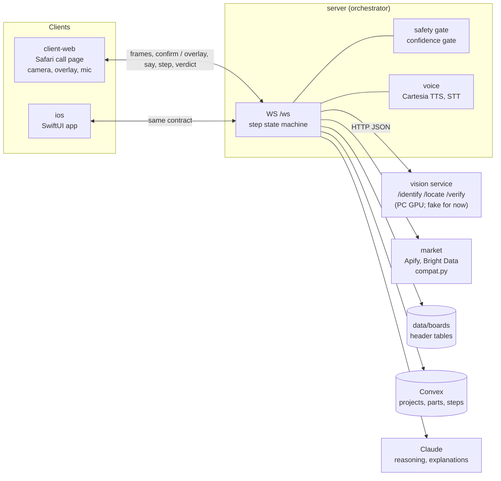

# A-eye

**An AI video call that knows your build.** Pronounced like "AI", spelled with an eye, because it sees.

You hold up a cable. A-eye sees what it is, draws an arrow to the exact spot on your motherboard where it goes
(taken from your board's own manual), says it in one sentence, and checks your work before you move on. It
remembers your build between calls, and when you ask "is there cheaper RAM?" it finds options that actually fit
the parts you own.

Status: Cal Hacks 13.0 build in progress. The skeleton runs with a fake vision model; real models land during the
weekend.

## The problem

Building or fixing a PC means a long manual, tiny silkscreen labels, and headers that look the same. Plug the CPU
fan into the system fan header and nothing warns you. Video assistants can talk about what they see, but they do not
know your board's manual, they do not check the step, and they forget your build when the call ends.

## Three core features

1. **Point, place, check.** Hold up the part. A tracked arrow lands on the right header from your board's manual,
   with the manual diagram beside it. After you plug it in, A-eye checks it and says pass, fail ("that is SYS_FAN1,
   not CPU_FAN"), or "I can't tell, move closer". It never guesses a green tick.
2. **My Build memory.** Your project keeps the board, the parts you own, the steps done and what went wrong. The
   next call starts with "Welcome back. RAM is done; next is the front panel."
3. **Check the market for my build.** "Cheaper RAM?" returns live prices with a plain reason for each: "fits because
   DDR5, DIMM, a speed your board supports". Compatibility is decided by rules in code; anything unknown is shown
   as "unverified", never "fits".

## What makes it different

| | Gemini Live | ChatGPT video | FixLens | A-eye |
|---|---|---|---|---|
| Points at the part on the live frame | Yes | No | Yes | Yes |
| Knows this board's manual (exact header, pin 1, which RAM slots) | No | No | No | Yes, hand-checked tables |
| Checks the step before the next one | No | No | Yes | Yes, and abstains when unsure |
| Remembers your build across calls | Chat memory | Chat memory | No | Yes, a saved project |
| Finds cheaper parts that fit what you own | No | No | No | Yes |

The comparison reflects our own review of these products before the event; we claim the combination, not a first.

## Safety and privacy, in code

- **Power off first.** No step starts until you confirm the PSU is off and unplugged.
- **Allowed parts only.** Fan cables, front panel, RAM, SATA, M.2, 24-pin and 8-pin EPS. Nothing about opening a
  PSU or mains power.
- **Confidence gate.** Low confidence means "move closer", not a guess. Every verdict shows its confidence.
- **No video stored.** Frames are processed and dropped. A local-only switch keeps frames on our own GPU.

## Architecture



Every message is defined once in [`contracts/schema.json`](contracts/schema.json). Step machine:
`SAFETY -> IDENTIFY -> LOCATE -> GUIDE -> AWAIT -> VERIFY -> DONE`, or `RETRY` back to `LOCATE`.

## Repo layout

| Path | What |
|---|---|
| `contracts/` | JSON Schemas, TypeScript and Python types, examples |
| `server/` | Orchestrator, state machine, gates |
| `vision/` | Vision service API (fake first, real on the GPU) |
| `voice/` | Cartesia TTS and STT adapter |
| `client-web/` | Safari call page |
| `ios/` | Native iPhone app |
| `market/` | Price search and compatibility checker |
| `data/` | Hand-checked header tables per board |
| `eval/` | Accuracy harness |
| `docs/` | Notes and pitch |

## Team

| Role | Who | Owns |
|---|---|---|
| A | Duc | iPhone app, contracts, integration |
| B | TBD | Vision on the GPU, model router |
| C | TBD | Market search, Convex store |
| D | TBD | Orchestrator, voice, eval, pitch |

## Sponsor tech

Planned, confirmed in this list only once it runs in the demo:
Cartesia (voice), Apify and Bright Data (live prices), Convex (project memory), Claude by Anthropic (reasoning).
Open models on our own GPU: Qwen2.5-VL (vision), Whisper (speech to text).

## Run it

Needs Python 3.11+, [uv](https://github.com/astral-sh/uv), and Node 20+ for the web tests.

```sh
make setup             # .venv + Python deps
cp .env.example .env   # fill keys locally; .env is gitignored
make test              # all module tests
make vision            # fake vision service on :8001
make server            # orchestrator on :8000; open http://localhost:8000
make smoke             # end to end: photo -> server -> fake vision -> box + step
```

Phone camera access in Safari needs HTTPS; use a tunnel (for example Tailscale Funnel) to reach the laptop.

See [AGENTS.md](AGENTS.md) for team rules and [CONTRIBUTING.md](CONTRIBUTING.md) for the PR flow.
